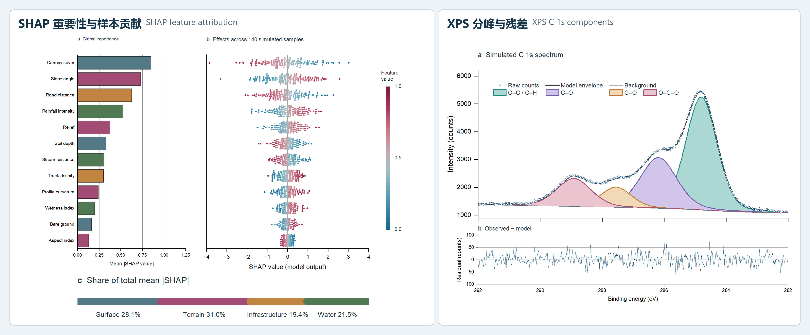

# Origin Scientific Plotting

[简体中文](README.md) · **English**

This is a set of instructions for an AI assistant, also called a Skill. After it is installed, you describe the figure in everyday language, and the assistant uses the Origin or OriginPro already installed on your Windows computer. You can draw a new figure from a table, or change an existing Origin project. The result is an Origin project file (OPJU) that you can open and edit again, plus a PNG, PDF, or TIFF when you need one.

[Download the Windows installer v0.1.2](dist/origin-plot-0.1.2-windows-x64.zip)

## Contents

- [What it can do for you](#what-it-can-do-for-you)
- [Before you start](#before-you-start)
- [Quick start](#quick-start)
- [Your first plot](#your-first-plot)
- [What to say next](#what-to-say-next)
- [Plot types and galleries](#plot-types-and-galleries)
- [Journal-ready figures](#journal-ready-figures)
- [If something gets in the way](#if-something-gets-in-the-way)
- [Run the installer yourself](#run-the-installer-yourself)
- [For maintainers](#for-maintainers)
- [Sponsorship](#sponsorship)
- [License](#license)

## What it can do for you

You can ask the assistant to:

- Draw a new figure from a CSV, TSV, or Excel table.
- Replace the data and keep the layout of an existing figure.
- Edit a saved Origin project and save a separate copy.
- Edit the figure you currently have open in Origin.
- Export to the common sizes used by the main Nature, Science, and Cell journals and by PLOS One, and list anything you still need to check yourself.
- Look through 20 ready-made plot types and 95 official Origin templates for a close example.

When it finishes, the assistant should give you an Origin project you can open, and a PNG preview. Ask for a PDF or TIFF when you need a file for submission.

[](docs/showcase/featured.png)

The left figure shows SHAP feature importance, the sample spread, and group shares. The right figure shows the XPS spectrum components, the fitted envelope, and the residuals. The full poster arranges 20 Origin figures in 4 rows and 5 columns. The gallery includes editable projects and matching tables for 18 of the examples. [SHAP figure](docs/showcase/plots/shap-summary.png) · [XPS figure](docs/showcase/plots/xps-components.png) · [20-figure poster](docs/showcase/preview.png) · [Gallery and reproduction steps](docs/showcase/README.md)

## Before you start

Check the following first:

- The computer is 64-bit Windows.
- Origin or OriginPro is installed, you can open it yourself, and the license is valid.
- The computer has 64-bit Python 3.13. The installer uses this version. The download already includes the other pieces it needs, so this step can finish offline when Python 3.13 is present. If that version is missing, the assistant should stop and tell you.
- The data and figures for this paper live in one folder. Installation applies to the current folder. A paper kept in another folder needs its own installation.
- The folder path may contain Chinese characters and spaces.
- Drawing is done in Codex, Claude Code, or OpenCode. Each of these assistants can read the folder and use Origin on your computer.

Any AI assistant that can read and write files on this computer can run the installation for you, including Cursor. The installer registers the plotting instructions with Codex, Claude Code, and OpenCode. After installation, open the same paper folder in one of those three to draw.

Drawing uses Origin on your computer. ToodooAI, the sponsor introduced at the end of this page, is separate from installation and drawing.

## Quick start

Follow these five steps and let an AI assistant install it.

1. Download the [Windows installer v0.1.2](dist/origin-plot-0.1.2-windows-x64.zip) and extract it to a folder.
2. Open an AI assistant that can work with files on this computer, in the folder where you keep the paper’s data and figures.
3. Send the whole message below. Change only two parts: the path of the extracted folder, and the assistant you will use for drawing. If you want all three, leave the second part as “三个都安装”.
4. When installation finishes, reopen this paper folder in the Codex, Claude Code, or OpenCode app you chose. If it asks whether to trust this project, or whether to allow access to this project’s settings, accept. After you accept, the assistant can use Origin on your computer.
5. Send the first message in the next section to draw a sample histogram.

The message below stays in Chinese. Send it as written, and replace only the extracted-folder path and the assistant name.

```text
请帮我在当前文件夹安装「Origin 科研绘图」。

安装包解压位置：【粘贴解压后的文件夹路径】
画图时我使用：【Codex、Claude Code、OpenCode，或三个都安装】

请完成安装，再用我能看懂的话告诉我：装到了哪里、要重新打开哪一个助手、如果出现访问本项目的确认提示该怎么选，以及我下一步可以怎么说来画一张示例直方图。

请遵守：
- 只在解压目录运行其中的安装程序，安装目标是当前文件夹。
- 需要 64 位 Windows 和 Python 3.13。没有时请停下来说明，不要改用其他 Python 版本。
- 不要修改、移动或删除我的实验数据和已有 Origin 工程。
- 在解压目录执行：py -3.13 .\install.py --project "当前文件夹完整路径" --clients all
  如果我只选了一个助手，把 all 换成 codex、claude 或 opencode。
```

## Your first plot

After you reopen the assistant, send this:

> Draw a histogram from the included example. Keep every original observation. Give me an Origin project I can open and edit, and export a PNG.

Once that figure exists, you can continue:

> Set the bin width to 2 and save a separate project. Keep the project you just made.

To change the figure you are looking at in Origin, leave that Origin window open and name the graph and the curve:

> The figure I want to change is the one open in Origin now. Change only this figure: make the second curve dashed and blue, then save a separate copy.

When you ask for a figure, include the file, the meaning of each column, the units, and whether the original file should be kept.

## What to say next

| What you want | What you can say |
| --- | --- |
| Draw a new figure from your own table | Use Origin to draw a grouped scatter plot from the sheet “实验 A” in `数据.xlsx`. The horizontal axis is leaf length in cm, the vertical axis is leaf width in cm, and the color shows the species. Keep the original table, save a project, and export a PNG. |
| Replace the data and keep the layout | Use the figure you just made, and replace the data with `重复实验.xlsx`. The columns mean the same thing as last time. Save a new project and keep the original project. |
| Edit the figure that is already open | In the Origin project I have open, change Graph1. Make only the second curve dashed, set its width to 2, make it blue, and save a separate copy. |
| Prepare a journal figure | This figure is for a single column in the main Nature journal. Export an editable PDF at that journal’s usual width, and tell me what I should check by eye. |
| Find a similar figure in the library | I want grouped box plots with the original observations. Find one close example among the ready-made plot types and one among the official templates, and tell me which columns the table needs. |
| State the units and keep the original | The concentration unit is μmol/L and the time unit is min. Put the units on the axes. Save every change as a new file and keep the original project. |

The step-by-step checks for graph pages and curves are in the [drawing and editing notes](skill/origin-plot/references/workflow.md), written in Chinese. You can ask the assistant to read those notes before it edits a figure.

## Plot types and galleries

Each of the 20 ready-made plot types comes with two synthetic examples, so you can try the path before using your own table. Reference pictures and column notes are in the [plot-type gallery](skill/origin-plot/assets/GALLERY.md). Fuller Origin figures, editable projects, and matching tables are in the [showcase](docs/showcase/README.md).

- General: multi-series line, scatter, grouped columns, percent stacked columns, point estimates with error bars, histogram, box plots with raw observations, violin plot, empirical cumulative distribution, heatmap, dual Y axes, and two-panel figure.
- Biology: dose–response and paired samples.
- Materials chemistry: stacked XRD and an EIS Nyquist plot.
- Economics and management: coefficient intervals and an event-study plot.
- Humanities: word frequency over time and a diverging Likert chart.

There are also 95 official Origin templates, with example projects and preview images. The official folder layout and license notes are kept. Ask the assistant to search by the Chinese names, or open the [Chinese index](resources/official/INDEX.md) yourself. The templates can also be downloaded on their own: [official template archive](dist/originlab-templates-a328793-offline.zip).

## Journal-ready figures

The assistant can check figure size and export format against four journal profiles, and list items that still need a person to confirm. When the measured values pass, you still need to look at the content, the layout, whether the colors can be told apart, and how the uncertainty is defined. For drafts, supplementary material, and graphical abstracts, follow the journal’s current page. Sources and review dates are in the [journal settings](skill/origin-plot/references/journals/README.md), written in Chinese.

- Nature: 89 mm for one column and 183 mm for two columns, with an intermediate width of 120–136 mm. An editable PDF, Adobe Illustrator (AI), or EPS file is the usual final format.
- Science: 90 mm for one column and 183 mm for two columns. An editable Adobe Illustrator (AI), EPS, or PDF file is the usual final format.
- Cell: maximum widths of 85 mm, 114 mm, and 174 mm for one, one and a half, and two columns. A single-page PDF or TIFF is the usual final format.
- PLOS One: width may be from 66.8 mm to 190.5 mm, and 132 mm is usual for a text column. A single-page LZW-compressed TIFF or EPS file is the usual final format.

When you change journals, ask the assistant to save a copy of the original project and apply the new journal’s settings there. Your study design, the definition of the intervals, and the mapping from data to curves stay as you set them.

## If something gets in the way

**The assistant says it cannot find Origin.** Open Origin yourself and confirm that you can enter the licensed program. Then return to the assistant and ask it to try again.

**A trust or access prompt appears.** Accept it. This allows the assistant to use the plotting instructions just installed in this folder.

**Installation stops halfway.** Ask the assistant to install again from the same extracted folder. Switching to a different version of the installer while an attempt is unfinished will stop the installation.

**You moved to another paper folder.** Install again in the new folder. The installation in the previous folder stays where it is.

**This computer does not yet have a working copy of Origin.** The assistant can still search the libraries and compare the columns in your table. An Origin project and an exported figure require Origin or OriginPro to be installed and able to open.

**You want to edit a figure that is already open.** Leave that Origin window open. In the conversation, say “the Origin project I currently have open,” and name the graph page or curve. If several Origin windows are open, say which one to change.

## Run the installer yourself

To run the installer yourself, download and extract it, open PowerShell in the extracted folder, and replace the path with your paper folder:

```powershell
py -3.13 .\install.py --project "D:\Research\Figures" --clients all
```

To install for one assistant, replace `all` with `codex`, `claude`, or `opencode`. After installation, you can delete the extracted folder. Then reopen the paper folder in the matching assistant and accept the prompt that asks for access to this project.

## For maintainers

You do not need this section for everyday plotting.

From an installed paper folder, you can check the local setup, search templates, and view journal guidance:

```powershell
py -3.13 .\.origin-plot\launch.py isolated doctor
py -3.13 .\.origin-plot\launch.py catalog search box --source official
py -3.13 .\.origin-plot\launch.py catalog show likert --source original
py -3.13 .\.origin-plot\launch.py journal prompt nature
```

The checks below try drawing, reuse a template with new data, make a targeted edit, and reopen the project. Results go to `.origin-plot/native-library` by default.

```powershell
py -3.13 .\.origin-plot\launch.py qualify offline
py -3.13 .\.origin-plot\launch.py qualify live --ids histogram likert xrd-stack
py -3.13 .\.origin-plot\launch.py qualify workflows
```

Omit `--ids` to check all 20 plot types. Use `--output` to write the results to another folder. [v0.1.2 native verification archive](dist/origin-plot-0.1.2-native-verification.zip)

To check a source checkout, run `py -3.13 tools/sync_official.py verify` and `py -3.13 tools/qualify.py offline`. After the backend package is prepared, run `py -3.13 tools/build_release.py --wheel-cache "D:\wheel-cache"` to rebuild the offline installer and the official template archive. [Backend notes, in Chinese](backend/README.md) · [Adding plot types and templates, in Chinese](skill/origin-plot/references/template-production.md)

## Sponsorship

You do not need to register for or buy ToodooAI to use this plotting assistant. Drawing uses Origin on your computer.

This project is sponsored by [ToodooAI](https://toodooai.com). ToodooAI is an AI model proxy that provides high-quality, undiluted GPT, Claude, DeepSeek, and other models. It charges by usage, lets you review that usage, and can be connected to an AI assistant. Available models and prices are those shown on the website at the time. For help connecting, join the QQ group published on the website: 1126234071.

## License

Rights to the program, the assistant instructions, and the templates written for this project are reserved. What you receive in the installer may be installed and used on your computer. Third-party components are covered by the licenses that accompany them. The Origin and OriginPro desktop programs are licensed separately by OriginLab.

[Project license](LICENSE.txt) · [Third-party sources](THIRD_PARTY.md)
