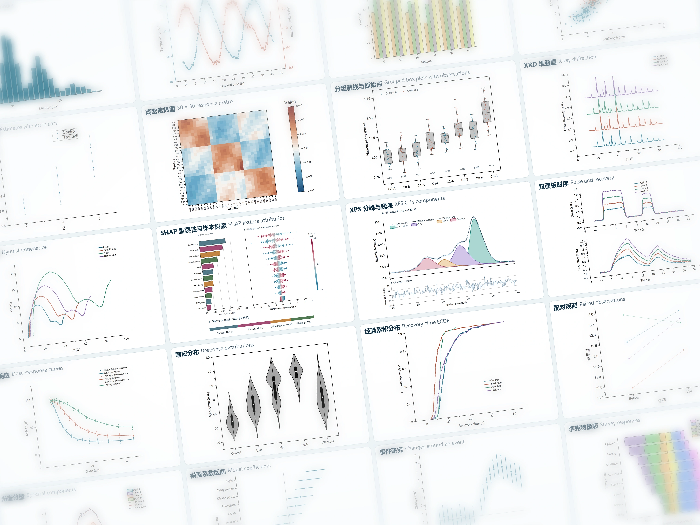

# Origin 科研绘图

**简体中文** · [English](README.en.md)

这是一份写给 AI 助手的操作说明，也叫 Skill。装好之后，你用平时的话描述想要的图，助手会在你的 Windows 电脑上调用已经安装的 Origin 或 OriginPro 来完成。你可以从表格画出新图，也可以修改已有工程。结果会保存成还能在 Origin 里继续改的工程文件（OPJU），并按需要导出 PNG、PDF 或 TIFF。

[下载 Windows 安装包 v0.1.3](dist/origin-plot-0.1.3-windows-x64.zip)

## 目录

- [它能帮你做什么](#它能帮你做什么)
- [开始之前](#开始之前)
- [快速开始](#快速开始)
- [画第一张图](#画第一张图)
- [之后可以怎么说](#之后可以怎么说)
- [图型和图库](#图型和图库)
- [期刊成稿](#期刊成稿)
- [遇到这些问题](#遇到这些问题)
- [自己运行安装程序](#自己运行安装程序)
- [给维护者](#给维护者)
- [赞助](#赞助)
- [许可](#许可)

## 它能帮你做什么

你可以让助手替你完成这些事：

- 根据 CSV、TSV 或 Excel 表格画一张新图。
- 换上一套新数据，并沿用已有图的版式。
- 修改已经保存的 Origin 工程，再另存一份。
- 修改你此刻在 Origin 里打开的那张图。
- 按 Nature、Science、Cell 主刊和 PLOS One 的常见尺寸导出，并标出仍要你亲自确认的地方。
- 在 20 种现成图型和 95 个 Origin 官方模板里查找接近的例子。

每次做完，助手应交回可打开的工程文件，以及一张 PNG 预览。需要投稿文件时，再导出 PDF 或 TIFF。

[](docs/showcase/preview.webp)

这张海报把 20 张 Origin 图排成 5 行 4 列，SHAP 与 XPS 放在中间一行。图集提供其中 18 个示例的可编辑工程和配套表格。[SHAP 原图](docs/showcase/plots/shap-summary.png) · [XPS 原图](docs/showcase/plots/xps-components.png) · [图集与复现说明](docs/showcase/README.md)

## 开始之前

请先确认这几件事：

- 电脑是 64 位 Windows。
- Origin 或 OriginPro 已经安装，你能自己打开它，并且授权有效。
- 电脑上有 64 位 Python 3.13。安装程序使用这个版本。安装包已经带好其余组件，有 Python 3.13 时，这一步可以离线完成。如果没有这个版本，助手会停下来说明。
- 这篇论文的数据和图放在同一个文件夹里。安装只对当前文件夹生效。另一篇论文如果换了文件夹，需要再安装一次。
- 文件夹路径可以包含中文和空格。
- 画图时使用 Codex、Claude Code 或 OpenCode。这三款助手都能在文件夹里阅读文件，并调用你电脑上的 Origin。

任何能在这台电脑上读写文件的 AI 助手都可以代你完成安装，Cursor 也可以。安装程序会把画图说明登记给 Codex、Claude Code 和 OpenCode。装好之后，请用这三款中的一款打开同一个论文文件夹来画图。

画图使用的是你电脑上的 Origin。

## 快速开始

按这五步，让 AI 助手帮你安装。

1. 下载 [Windows 安装包 v0.1.3](dist/origin-plot-0.1.3-windows-x64.zip)，并解压到一个文件夹。
2. 打开一个能操作这台电脑上文件的 AI 助手，进入存放论文数据和图的文件夹。
3. 把下面整段话发给它。只改两处：解压后的文件夹路径，以及你画图时要使用的助手。三个都安装时，第二处写「三个都安装」。
4. 安装完成后，用你选中的 Codex、Claude Code 或 OpenCode 重新打开这个论文文件夹。如果它询问是否信任本项目，或是否允许访问本项目的配置，请同意。同意之后，助手才能调用你电脑上的 Origin。
5. 把下一节的第一段话发给它，先画一张示例直方图。

```text
请帮我在当前文件夹安装「Origin 科研绘图」。

安装包解压位置：【粘贴解压后的文件夹路径】
画图时我使用：【Codex、Claude Code、OpenCode，或三个都安装】

请完成安装，再用我能看懂的话告诉我：装到了哪里、要重新打开哪一个助手、如果出现访问本项目的确认提示该怎么选，以及我下一步可以怎么说来画一张示例直方图。

请遵守：
- 只在解压目录运行其中的安装程序，安装目标是当前文件夹。
- 需要 64 位 Windows 和 Python 3.13。没有时请停下来说明，不要改用其他 Python 版本。
- 不要修改、移动或删除我的实验数据和已有 Origin 工程。
- 在解压目录执行：py -3.13 .\install.py --project "当前文件夹完整路径" --clients all
  如果我只选了一个助手，把 all 换成 codex、claude 或 opencode。
```

## 画第一张图

安装并重新打开助手之后，先发这段话：

> 用自带示例画一张直方图，保留每一个原始数据点。请给我能在 Origin 里继续打开修改的工程文件，并导出一张 PNG。

图已经生成后，可以接着说：

> 把箱宽改为 2，另存一份工程，保留刚才那一份。

如果要改的是你正在 Origin 里看着的那张图，请保持 Origin 窗口打开，并说清楚是哪一张图、哪一条线：

> 我现在 Origin 里打开的就是要改的图。请只改这一张：把第二条线改成虚线，颜色用蓝色，然后另存一份。

说图的时候，尽量写上数据在哪个文件、哪一列是什么、单位是什么，以及要保留原文件。

## 之后可以怎么说

| 你的目的 | 可以这样说 |
| --- | --- |
| 用自己的表格画一张新图 | 请用 Origin 根据 `数据.xlsx` 的「实验 A」表画分组散点。横轴是叶长，单位 cm；纵轴是叶宽，单位 cm；按物种分色。保留原表格，另存工程并导出 PNG。 |
| 换一套数据，版式保持不变 | 请沿用刚才的图，把数据换成 `重复实验.xlsx`。列的含义与上次相同。另存一份新工程，原工程保留。 |
| 修改已经打开的图 | 我当前打开的 Origin 工程里，要改的是 Graph1。请只把第二条曲线改成虚线、线宽 2，颜色用蓝色，并另存。 |
| 按期刊准备成稿 | 这张图准备投 Nature 主刊，放在单栏。请按该刊的常见宽度导出可编辑 PDF，并告诉我哪些地方需要我自己再看一眼。 |
| 在图库里找相近的图 | 我想画带原始数据点的分组箱线。请先在现成图型和官方模板里各找一个接近的例子，告诉我表格需要哪些列。 |
| 写明单位，并保留原件 | 浓度单位是 μmol/L，时间单位是 min。请把单位写到坐标轴上。所有修改都另存，原工程保留。 |

逐项核对图页和曲线的步骤，写在[绘图与改图说明](skill/origin-plot/references/workflow.md)里。你可以让助手先阅读这份说明，再改图。

## 图型和图库

20 种现成图型各有两份合成示例，方便先走通，再换成自己的表。对照图和列说明见[图型参考](skill/origin-plot/assets/GALLERY.md)。更完整的 Origin 原图、可编辑工程和配套表格见[图集](docs/showcase/README.md)。

- 通用：多系列折线、散点、分组柱、百分比堆叠柱、点估计与误差线、直方图、箱线叠原始点、小提琴图、经验累积分布、热图、双 Y 轴、双面板图。
- 生物：剂量反应、配对样本。
- 材料化学：XRD 堆叠、电化学阻抗谱的 Nyquist 图。
- 经管：回归系数区间、事件研究动态效应。
- 文科：语料词频历时、李克特发散堆叠。

另有 95 个 Origin 官方模板，附带示例工程和预览图，并保留官方的目录和许可说明。可以让助手按中文名称查找，也可以自己打开[中文索引](resources/official/INDEX.md)。模板也可以单独下载：[官方模板压缩包](dist/originlab-templates-a328793-offline.zip)。

## 期刊成稿

助手可以按四份主刊设置检查成图的尺寸和导出格式，并列出仍需人工确认的项目。数值都符合时，仍要自己查看内容、排布、颜色是否分得清，以及误差的定义。初稿、补充材料和图形摘要，以期刊当页说明为准。各项的来源和核对日期见[期刊设置](skill/origin-plot/references/journals/README.md)。

- Nature：单栏 89 mm，双栏 183 mm，也可使用 120–136 mm 的中间宽度；终稿常用可编辑的 PDF、Adobe Illustrator（AI）或 EPS。
- Science：单栏 90 mm，双栏 183 mm；终稿常用可编辑的 Adobe Illustrator（AI）、EPS 或 PDF。
- Cell：一栏、一栏半和两栏的最大宽度分别是 85 mm、114 mm 和 174 mm；终稿常用单页 PDF 或 TIFF。
- PLOS One：宽度可在 66.8–190.5 mm 之间，正文栏常用 132 mm；终稿常用单页 LZW 压缩的 TIFF 或 EPS。

换期刊时，请让助手从原工程另存一份，再按新刊重新设置。你的实验设计、区间定义和数据对应关系保持原样。

## 遇到这些问题

**助手说找不到 Origin。** 先自己打开 Origin，确认能进入已授权的软件。然后回到助手，让它再试一次。

**出现信任或允许访问的提示。** 选择同意。这是在允许助手使用刚才安装到本文件夹里的绘图说明。

**安装到一半停住。** 用刚才那一个解压目录，让助手再安装一次。中途换另一个版本的安装包时，安装会停下来。

**换了一个论文文件夹。** 在新文件夹里再安装一次。上一个文件夹里的安装继续留在原处。

**这台电脑还没有可用的 Origin。** 助手仍然可以查找图库，并对照表格里的列。要得到 Origin 工程和导出图，需要先装好并能打开 Origin 或 OriginPro。

**要改的是已经打开的图。** 保持那个 Origin 窗口开着。在对话里写明「我当前打开的 Origin 工程」，并指出图页或曲线。如果同时开着多个 Origin 窗口，先告诉助手要改哪一个。

## 自己运行安装程序

如果你希望自己运行安装程序，先下载并解压安装包，在解压后的文件夹里打开 PowerShell，把路径换成你的论文文件夹：

```powershell
py -3.13 .\install.py --project "D:\研究项目\论文图" --clients all
```

只安装给一个助手时，把 `all` 换成 `codex`、`claude` 或 `opencode`。安装完成后，可以删除解压出来的文件夹。然后用对应的助手重新打开论文文件夹，并同意它访问本项目的提示。

## 给维护者

日常画图不用看这一节。

在已经安装的论文文件夹中，可以检查本机状态、查找模板和查看期刊要求：

```powershell
py -3.13 .\.origin-plot\launch.py isolated doctor
py -3.13 .\.origin-plot\launch.py catalog search 箱线 --source official
py -3.13 .\.origin-plot\launch.py catalog show likert --source original
py -3.13 .\.origin-plot\launch.py journal prompt nature
```

下面的检查会试画图、用模板换数据、做局部修改，并重新打开工程核对。结果默认写在 `.origin-plot/native-library`。

```powershell
py -3.13 .\.origin-plot\launch.py qualify offline
py -3.13 .\.origin-plot\launch.py qualify live --ids histogram likert xrd-stack
py -3.13 .\.origin-plot\launch.py qualify workflows
```

去掉 `--ids` 会检查全部 20 种图型。使用 `--output` 可以把结果写到另一个文件夹。[v0.1.2 实机验收文件](dist/origin-plot-0.1.2-native-verification.zip)

从源码复核时，运行 `py -3.13 tools/sync_official.py verify` 与 `py -3.13 tools/qualify.py offline`。准备好后端安装包之后，用 `py -3.13 tools/build_release.py --wheel-cache "D:\wheel-cache"` 重新生成离线安装包和官方模板包。[后端说明](backend/README.md) · [新增图型与模板](skill/origin-plot/references/template-production.md)

## 赞助

[](https://toodooai.com)

本项目由 [ToodooAI](https://toodooai.com) 赞助。ToodooAI 是 AI 模型中转服务，提供优质、不掺水的 GPT、Claude、DeepSeek 等模型。服务按使用量计费，可以查看用量，适合接入 AI 助手。可用模型和价格以官网当时页面为准。接入时如果需要帮助，可加入官网公布的 QQ 群：1126234071。

<table>
  <tr>
    <td></td>
    <td></td>
  </tr>
  <tr>
    <td></td>
    <td></td>
  </tr>
</table>

## 许可

本项目自己编写的程序、给助手看的说明和自制模板，权利予以保留。随安装包得到的内容可以在你的电脑上安装和使用。第三方组件按它们各自随附的许可使用。Origin 与 OriginPro 桌面软件由 OriginLab 另行授权。

[项目许可](LICENSE.txt) · [第三方来源](THIRD_PARTY.md)
