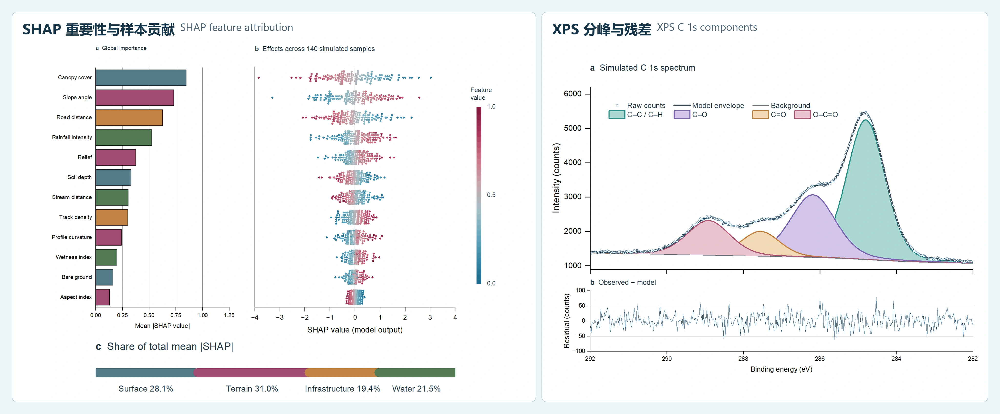

# Origin 绘图图集 · Origin Plot Gallery

[简体中文主页](../../README.md) · [English home](../../README.en.md) · [20 图海报 / 20-figure poster](preview.webp) · [下载可编辑工程、CSV 与重开记录 / Download editable projects, CSVs, and reopen records](projects.zip)

[](featured.webp)

完整海报以 4 × 5 的等尺寸卡片构成倾斜图阵，SHAP 与 XPS 居中，外围带有柔焦。配对样本图与点估计误差线图沿用原生验收预览。[v0.1.2 验收包](../../dist/origin-plot-0.1.2-native-verification.zip)

The full poster centers SHAP and XPS in a tilted 4 × 5 mosaic of equal-size cards, with soft focus around the edges. The paired-sample and point-estimate error bar plots come from the native verification previews. [v0.1.2 verification archive](../../dist/origin-plot-0.1.2-native-verification.zip)

## 18 个可编辑示例 · 18 editable examples

点击图名可打开 Origin 导出的完整 PNG。压缩包包含可复现的合成输入 CSV 和带可编辑工作表及图页的 OPJU。

Select a plot title to open the full PNG exported by Origin. The archive includes reproducible synthetic CSV inputs and OPJUs with editable worksheets and graph pages.

| 图表 / Plot | 合成数据与图层 / Synthetic input and layers |
| --- | --- |
| [SHAP 变量重要性与样本贡献 / SHAP importance and beeswarm](plots/shap-summary.png) | 对含成对交互项的合成模型，以独立、对称的输入分布为基准，解析计算 140 个样本、12 个变量的 SHAP 值。柱形展示平均绝对 SHAP，蜂群点按归一化特征值着色，分组份额为组内平均绝对 SHAP 之和占总和的比例。 / Analytical SHAP values for 12 features and 140 samples from a synthetic model with pairwise interactions and an independent, symmetric reference distribution. Bars show mean absolute SHAP. Swarm colors encode scaled feature values. Each group’s share divides its sum of mean absolute SHAP by the sum across all features. |
| [XPS C 1s 分峰与残差 / XPS C 1s components and residuals](plots/xps-components.png) | C 1s 模拟谱包含 401 个结合能采样点。上图展示观测、背景、四个给定的伪 Voigt 分量和叠加包络，下图展示观测减包络的残差。 / A simulated spectrum sampled at 401 binding energies. The upper panel shows observed counts, background, four supplied pseudo-Voigt components, and their combined envelope. The lower panel shows observed counts minus the envelope. |
| [30 × 30 热图 / 30 × 30 heatmap](plots/heatmap.png) | 30 个特征在 30 个条件下的响应，按特征计算 z 分数。 / Responses for 30 features across 30 conditions, standardized to z-scores within each feature. |
| [分组箱线与原始点 / Grouped box plots with observations](plots/box-raw.png) | 四种条件、两个队列，共 192 个归一化响应值。 / 192 normalized responses across four conditions and two cohorts. |
| [XRD 堆叠图 / Stacked XRD patterns](plots/xrd-stack.png) | 四种处理状态的衍射图谱，每条曲线 1,201 个点。 / Diffraction patterns for four treatments, with 1,201 points per curve. |
| [EIS Nyquist 图 / EIS Nyquist plot](plots/eis-nyquist.png) | 四种状态的等效电路阻抗，每种包含 85 个对数等距的频率点。 / Equivalent-circuit impedance for four states, each evaluated at 85 log-spaced frequencies. |
| [双面板时序 / Drive and response](plots/multi-panel.png) | 四种增益下的双脉冲及对应响应，每条曲线 281 个时间点。 / Paired drive pulses and their responses at four gains, with 281 time points per curve. |
| [UV–Vis 光谱分量 / UV–Vis spectral components](plots/multi-line.png) | 带噪模拟观测、基线、四个高斯峰及叠加模型。 / Simulated noisy observations, baseline, four Gaussian peaks, and their combined model. |
| [剂量响应 / Dose–response](plots/dose-response.png) | 三种测定、15 个剂量，每个测定在各剂量下重复 8 次。 / Three assays at 15 doses, with eight replicate readings per assay and dose. |
| [小提琴图 / Violin plot](plots/violin.png) | 五组处理的 532 个响应值。 / 532 responses across five treatment groups. |
| [分组散点 / Grouped scatter plot](plots/scatter.png) | 四个物种的 384 对叶长与叶宽。 / 384 paired leaf length and width measurements across four species. |
| [经验累积分布 / Empirical cumulative distribution](plots/ecdf.png) | 四组共 715 个恢复时间。 / 715 recovery times across four groups. |
| [系数区间图 / Coefficient intervals](plots/coefficient-interval.png) | 11 个预测变量的标准化效应量及区间。 / Standardized effects and intervals for 11 predictors. |
| [事件研究 / Event study](plots/event-study.png) | 事件前后共 20 个分期估计值及区间，参照期为事件前一个月。 / Twenty estimates with intervals before and after an event, using the preceding month as the reference. |
| [分组柱状图 / Grouped bars](plots/grouped-column.png) | 六种材料经四种方法处理后的收率。 / Yields for six materials processed using four methods. |
| [双 Y 轴时序 / Dual-axis time series](plots/dual-y.png) | 48 小时内每 30 分钟记录一次温度与相对湿度。 / Temperature and relative humidity sampled every 30 minutes over 48 hours. |
| [直方图 / Histogram](plots/histogram.png) | 三种延迟分布混合生成的 960 次观测。 / 960 observations sampled from a mixture of three latency distributions. |
| [李克特发散堆叠 / Diverging Likert chart](plots/likert.png) | 八个问卷条目的五级作答频数。 / Five-level response counts for eight survey items. |

初次尝试配方时，可用规模更小的示例搭配参考图练习。[配方与参考图](../../skill/origin-plot/assets/GALLERY.md)

For a first run with a recipe, use the compact CSV examples and reference plots in the catalog. [Recipes and reference plots](../../skill/origin-plot/assets/GALLERY.md)

## 复现 · Reproduce

将离线包安装到本仓库目录。确认 Origin 可用后，从仓库根目录运行以下 PowerShell 命令。[快速开始](../../README.md#快速开始)

Install the offline bundle into this checkout. With Origin available, run the following PowerShell commands from the repository root. [Quick start](../../README.en.md#quick-start)

```powershell
$showcasePython = (Get-Content -LiteralPath '.origin-plot/state.json' -Raw | ConvertFrom-Json).python
& $showcasePython tools/build_showcase.py
```

脚本生成合成数据，在隔离 Origin 会话中绘图并检查工程能否重开，然后用独立启动的 Origin 以只读方式打开工程并导出 PNG。此导出路径避开本机 OriginPro 2024 SR1 在自动化模式下绘制文本时出现的上横线。[OriginLab 技术支持记录](https://my.originlab.com/forum/topic.asp?TOPIC_ID=48427)

The builder generates the synthetic inputs, draws the figures and checks project reopening in an isolated Origin session, then opens each project read-only in standalone Origin to export its PNG. This export path avoids the overlines that OriginPro 2024 SR1 can produce on text in automation mode. [OriginLab support report](https://my.originlab.com/forum/topic.asp?TOPIC_ID=48427)

[常规合成图数据 / Standard synthetic inputs](../../tools/showcase_data.py) · [SHAP 与 XPS 数据 / SHAP and XPS inputs](../../tools/showcase_advanced.py) · [绘图与构建脚本 / Drawing and build script](../../tools/build_showcase.py)
