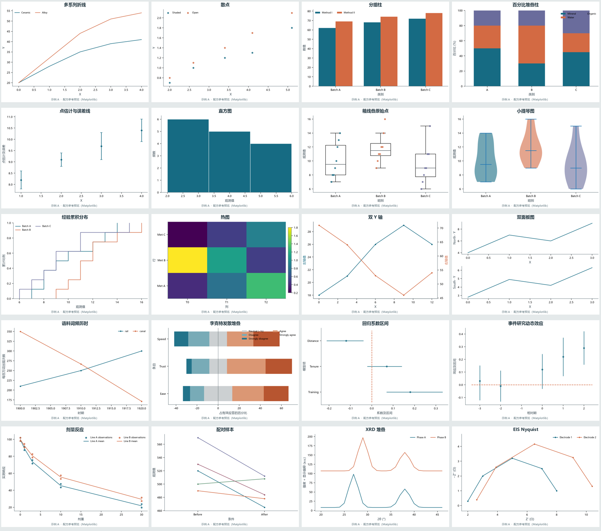

# 自制模板参考图

20 份参考图根据示例 A 渲染。通过实机验收时另存 Origin 原生预览。

| 图型 | 预览 | 数据与绘图说明 |
|---|---|---|
| 多系列折线 | [参考图](previews/multi-line.png) | [配方](recipes/multi-line/recipe.json) · [示例 A](recipes/multi-line/example-a.csv) · [示例 B](recipes/multi-line/example-b.csv) |
| 散点 | [参考图](previews/scatter.png) | [配方](recipes/scatter/recipe.json) · [示例 A](recipes/scatter/example-a.csv) · [示例 B](recipes/scatter/example-b.csv) |
| 分组柱 | [参考图](previews/grouped-column.png) | [配方](recipes/grouped-column/recipe.json) · [示例 A](recipes/grouped-column/example-a.csv) · [示例 B](recipes/grouped-column/example-b.csv) |
| 百分比堆叠柱 | [参考图](previews/percent-stack.png) | [配方](recipes/percent-stack/recipe.json) · [示例 A](recipes/percent-stack/example-a.csv) · [示例 B](recipes/percent-stack/example-b.csv) |
| 点估计与误差线 | [参考图](previews/point-error.png) | [配方](recipes/point-error/recipe.json) · [示例 A](recipes/point-error/example-a.csv) · [示例 B](recipes/point-error/example-b.csv) |
| 直方图 | [参考图](previews/histogram.png) | [配方](recipes/histogram/recipe.json) · [示例 A](recipes/histogram/example-a.csv) · [示例 B](recipes/histogram/example-b.csv) |
| 箱线叠原始点 | [参考图](previews/box-raw.png) | [配方](recipes/box-raw/recipe.json) · [示例 A](recipes/box-raw/example-a.csv) · [示例 B](recipes/box-raw/example-b.csv) |
| 小提琴图 | [参考图](previews/violin.png) | [配方](recipes/violin/recipe.json) · [示例 A](recipes/violin/example-a.csv) · [示例 B](recipes/violin/example-b.csv) |
| 经验累积分布 | [参考图](previews/ecdf.png) | [配方](recipes/ecdf/recipe.json) · [示例 A](recipes/ecdf/example-a.csv) · [示例 B](recipes/ecdf/example-b.csv) |
| 热图 | [参考图](previews/heatmap.png) | [配方](recipes/heatmap/recipe.json) · [示例 A](recipes/heatmap/example-a.csv) · [示例 B](recipes/heatmap/example-b.csv) |
| 双 Y 轴 | [参考图](previews/dual-y.png) | [配方](recipes/dual-y/recipe.json) · [示例 A](recipes/dual-y/example-a.csv) · [示例 B](recipes/dual-y/example-b.csv) |
| 双面板图 | [参考图](previews/multi-panel.png) | [配方](recipes/multi-panel/recipe.json) · [示例 A](recipes/multi-panel/example-a.csv) · [示例 B](recipes/multi-panel/example-b.csv) |
| 语料词频历时 | [参考图](previews/corpus-frequency.png) | [配方](recipes/corpus-frequency/recipe.json) · [示例 A](recipes/corpus-frequency/example-a.csv) · [示例 B](recipes/corpus-frequency/example-b.csv) |
| 李克特发散堆叠 | [参考图](previews/likert.png) | [配方](recipes/likert/recipe.json) · [示例 A](recipes/likert/example-a.csv) · [示例 B](recipes/likert/example-b.csv) |
| 回归系数区间 | [参考图](previews/coefficient-interval.png) | [配方](recipes/coefficient-interval/recipe.json) · [示例 A](recipes/coefficient-interval/example-a.csv) · [示例 B](recipes/coefficient-interval/example-b.csv) |
| 事件研究动态效应 | [参考图](previews/event-study.png) | [配方](recipes/event-study/recipe.json) · [示例 A](recipes/event-study/example-a.csv) · [示例 B](recipes/event-study/example-b.csv) |
| 剂量反应 | [参考图](previews/dose-response.png) | [配方](recipes/dose-response/recipe.json) · [示例 A](recipes/dose-response/example-a.csv) · [示例 B](recipes/dose-response/example-b.csv) |
| 配对样本 | [参考图](previews/paired-sample.png) | [配方](recipes/paired-sample/recipe.json) · [示例 A](recipes/paired-sample/example-a.csv) · [示例 B](recipes/paired-sample/example-b.csv) |
| XRD 堆叠 | [参考图](previews/xrd-stack.png) | [配方](recipes/xrd-stack/recipe.json) · [示例 A](recipes/xrd-stack/example-a.csv) · [示例 B](recipes/xrd-stack/example-b.csv) |
| EIS Nyquist | [参考图](previews/eis-nyquist.png) | [配方](recipes/eis-nyquist/recipe.json) · [示例 A](recipes/eis-nyquist/example-a.csv) · [示例 B](recipes/eis-nyquist/example-b.csv) |
